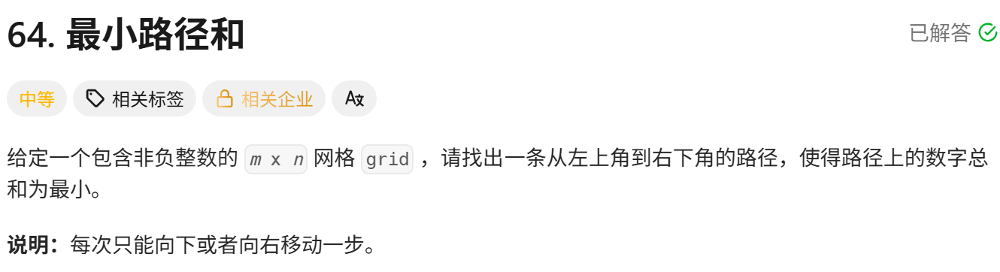
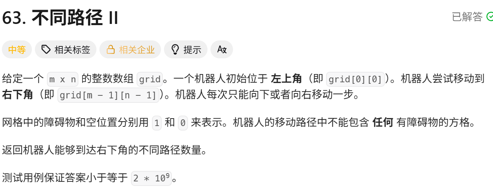
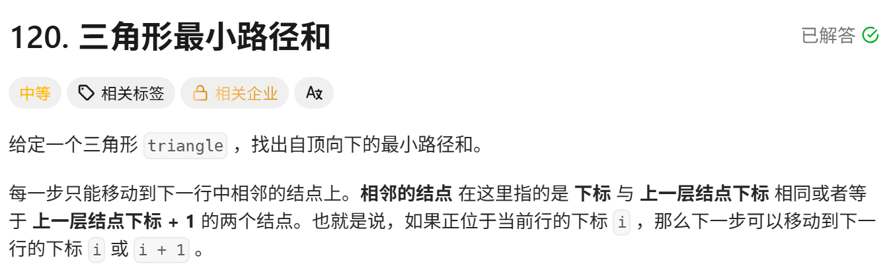

<!-- daily-note-2026-10-11 -->
# 2026-10-11 学习记录

<!-- weather-start -->
## 今日天气
- 当前天气：☀️ 晴天
- 当前温度：26.0 ℃
- 湿度：50 %
- 今日最高温：26.0 ℃
- 今日最低温：16.6 ℃
<!-- weather-end -->

<!-- plan-start -->
> 今日计划：
1.一题，尽量不看AI，直接最优解
<!-- plan-end -->
---
## 今日总结
### 刷题记录
题目1：最小路径和

``` GO
func minPathSum(grid [][]int) int {
    m := len(grid)
    n := len(grid[0])
    dp := make([][]int, n)
    for i in range m{
        dp[i] = make([]int,n)
    }
    for i := range m{
        if i == 0{
            dp[i][0] = grid[i][0]
        }else{
            dp[i][0] = dp[i-1][0] + grid[i][0]
        }
    }
    for j := range n{
        if j == 0{
            dp[0][j] = grid[0][j]
        }else{
            dp[0][j] = dp[0][j-1] + grid[0][j]
        }
    }
    for i:= 1;i<m;i++{
        for j:= 1;j<n;j++{
            dp[i][j] = min(dp[i-1][j],dp[i][j-1]) + grid[i][j]
        }
    }
    return dp[i-1][j-1]
}
```
```python
class Solution:
    def minPathSum(self, grid:List[List[int]]) -> int:
        m = len(grid)
        n = len(grid[i])
        dp = [[0]*n for _ in range m]
        for i in range m:
            if i ==0:
                dp[i][0] = grid[i][0]
            else:
                dp[i][0] = dp[i-1][0] + grid[i][0]
        for j in range n:
            if j == 0:
                dp[j][0] = grid[j][0]
            else:
                dp[0][j] = dp[0][j-1] + grid[0][j]
        for i in range(1,m):
            for j in range(1,n):
                dp[i][j] = min(dp[i-1][j],dp[i][j-1]) + grid[i][j]
        return dp[-1][-1]
```
题目2：不同路径II

``` Go
func uniquePathsWithObstacles(obstacleGrid [][]int) int{
    m := len(obstacleGrid)
    n := len(obstacleGrid[i])
    if m==0||obstacleGrid[0][0] == 0{
        return 0
    }
    dp := make([][]int,m)
    for i:0;i<m;i++{
        dp[i] = make([]int,n)
    }
    dp[0][0] = 1
    for i:=1;i<m;i++{
        if obstacleGrid[i][0]==1{
            dp[i][0] = 0
        }else{
            dp[i][0] = dp[i-1][0]
        }
    }
    for i:=1;i<n;i++{
        if obstacleGrid[][i]==1{
            dp[0][i] = 0
        }else{
            dp[0][i] = dp[0][i-1]
        }
    }
    for i:=1;i<m;i++{
        for j:=1;j<n;j++{
            dp[i][j] = dp[i-1][j] +dp[i][j-1]
        }
    }
    return dp[m-1][n-1]
}
```
``` python
class Solution:
    def uniquePathsWithObstacles(self, obstacleGrid:List[List[int]]) -> int:
        m = len(obstacleGrid)
        n = len(obstacleGrid[0])
        if m ==0 or obstacleGrid[0][0] ==1:
            return 0
        dp = [[0]*n for _ in range(m)]
        dp[0][0] = 1
        for i in range(1,m):
            if obstacleGrid[i][0] == 1:
                dp[i][0] = 0
            else:
                dp[i][0] = dp[i-1][0]
        for i in range(1,n):
            if obstacleGrid[0][i] == 1:
                dp[0][i] = 0
            else:
                dp[0][i] = dp[0][i-1]
        for i in range(1,m):
            for j in range(1,n):
                if obstacleGrid[i][j]==1:
                    dp[i][j] = 0
                else:
                    dp[i][j] = dp[i-1][j] + dp[i][j-1]
        return dp[-1][-1]
```
题目3：三角形最小路径和

``` Go
func minimunTotal(triangle [][]int) int{
    m := len(triangle)
    dp := make([][]int ,m)
    for i := 0;i<m;i++{
        dp[i] = make([]int,i+1)
    }
    dp[0][0] = triangle[0][0]
    for i :=1;i<m;i++{
        dp[i][0] = dp[i-1][0] + triangle[i][0]
        dp[i][i] = dp[i-1][i-1] + triangle[i][i]
        for j := 1;j<i;j++{
            dp[i][j] = min(dp[i-1][j-1],dp[i-1][j]) + triangle[i][j]
        }
    }
    minVal := dp[m-1][0]
    for i:=1;i<m;i++{
        if minVal > dp[m-1][i]{
            minVal = dp[m-1][i]
        }
    }
    return minVal
}
```
``` python
class Solution:
    def minimunTotal(self, triangle:List[List[int]]) -> int:
        m = len(triangle)
        dp = [[0]*(i+1) for i in range(m)]
        dp[0][0] = triangle[0][0]
        for i in range(1,m):
            dp[i][0] = dp[i-1][0] + triangle[i][0]
            dp[i][i] = dp[i-1][i-1] + triangle[i][i]
            for j in range(1,i):
                dp[i][j] = min(dp[i-1][j-1],dp[i-1][j]) + triangle[i][j]
        return min(dp[m-1])
```

### 收获
本次刷了三道网格动态规划题目：最小路径和、不同路径 II、三角形最小路径和。掌握二维动态规划的基本解题框架，学会定义 dp 状态、推导状态转移方程，理解网格类问题边界初始化的要点，重点体会一维滚动数组的空间优化原理，将空间复杂度从\(O(mn)\)优化到\(O(n)\)。刷题过程发现很多错误来源于审题不清、边界考虑不全、最值判断条件写反、Go 语言切片使用语法错误。后续解题将遵循：先分析移动规则，手动推演小样例，再编写代码，同时增加空输入等边界判断，锻炼 DP 优化思维。

> 明日计划：
1.一题，尽量不看AI，直接最优解
---
