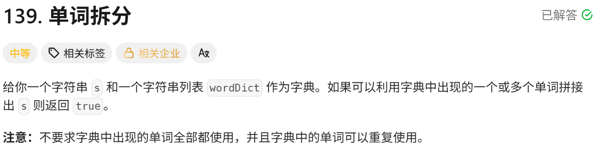

<!-- daily-note-2026-10-13 -->
# 2026-10-13 学习记录

<!-- weather-start -->
## 今日天气
- 当前天气：🌤 大部晴朗
- 当前温度：26.6 ℃
- 湿度：56 %
- 今日最高温：26.6 ℃
- 今日最低温：17.7 ℃
<!-- weather-end -->

<!-- plan-start -->
> 今日计划：
1.一题，尽量不看AI，直接最优解
<!-- plan-end -->
---
## 今日总结
### 刷题记录
题目1：最大正方形

``` GO
func maximalSquare(matrix [][]int) int{
    m := len(matrix)
    if m == 0{
        return 0
    }
    n := len(matrix[0])
    dp := make([][]int,m)
    for i:=0;i<m;i++{
        dp[i] = make([]int,n)
    }
    maxsid := 0
    for i:=0;i<m;i++{
        for j:=0;j<n;j++{
            if matrix[i][j] == '1'{
                if i==0||j==0{
                    dp[i][j] = 1
                }else{
                    dp[i][j] = min(dp[i-1][j-1],dp[i-1][j],dp[i][j-1]) + 1
                }
                maxside = max(maxside,dp[i][j])
            }
        }
    }
    return maxside*maxside
}
```
``` python
class Solution:
    def maximalSquare(self,matrix: List[List[int]]) -> int:
        m = len(matrix)
        if m == 0:
            return 0
        n = len(matrix[0])
        dp = [[0]*n for _ in range(m)]
        maxside = 0
        for i in range(m):
            for j in range(n):
                if matrix[i][j] == '1':
                    if i==0 or j==0:
                        dp[i][j] = 1
                    else:
                        dp[i][j] = min(dp[i-1][j-1],dp[i-1][j],dp[i][j-1]) + 1
                    maxside = max(maxside,dp[i][j])
        return maxside*maxside
```
题目2：最长回文子串

``` Go
func longestPalindrome(s string) string {
    n := len(s)
    if n<=1{
        return s
    }
    dp := make([][]bool, n)
    for i:=0;i<n;i++{
        dp[i] = make([]bool,n)
    }
    for i:=0;i<n;i++{
        dp[i][i] = true
    }
    maxlen := 1
    start := 0
    for j:=0;j<n;j++{
        for i:=0;i<j;i++{
            if s[i] == s[j]{
                if j-i<=2{
                    dp[i][j] = true
                }else{
                    dp[i][j] = dp[i+1][j-1]
                }
            }
            if dp[i][j]{
                curlen := j-i+1
                if curlen > maxlen{
                    maxlen = curlen
                    start = i
                }
            }
        }
    }
    return s[start: start+maxlen]
}
```
``` python
class Solution:
    def longestPalindrome(self, s: str) -> str:
        n = len(s)
        if n <= 1:
            return s
        dp = [[False]*n for _ in range(n)]
        for i in range(n):
            dp[i][i] = True
        for j in range(n):
            fori in range(j):
                if s[i] == s[j] :
                    if j-i<=2:
                        dp[i][j] = True
                    else:
                        dp[i][j] = dp[i+1][j-1]
                if dp[i][j]:
                    curlen = j-i+1
                    if curlen > maxlen:
                        maxlen = curlen
                        start = i
        return start[start:start+maxlen]
```
题目3：单词拆分

``` Go
func wordBreak(s string, wordDict []string) bool{
    wordMap := make(map[string]bool)
    for _,v := range(wordDict){
        wordMap[v] = true 
    }
    n := len(s)
    dp := make([]bool,n+1)
    dp[0] = true
    for i:=1;i<=n;i++{
        for j:=0;j<i;j++{
            if dp[j] && wordMap[s[j:i]]{
                dp[i] = true
                break
            }
        }
    }
    return dp[n]
}
```
``` python
class Solution:
    def wordBreak(self,s: str,wordDict: List[str]) -> bool:
        word_set = set(wordDict)
        n = len(s)
        dp = [False]*(n+1)
        dp[0] = True
        for i in range(1,n+1):
            for j in range(i):
                if dp[j] and s[j:i] in word_set:
                    dp[i] = True
                    break
        return dp[n]
```

### 收获
今日感悟：动态规划核心是拆分问题，不同问题对应的子问题形式决定 dp 数组形态。网格 DP、双字符串 DP、区间 DP、一维前缀 DP 虽然都叫 DP，但状态定义、遍历顺序完全不一样，需要先判断问题类型，再建模。

> 明日计划：
1.一题，尽量不看AI，直接最优解

---
