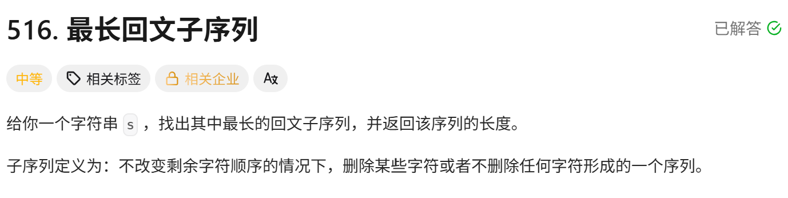
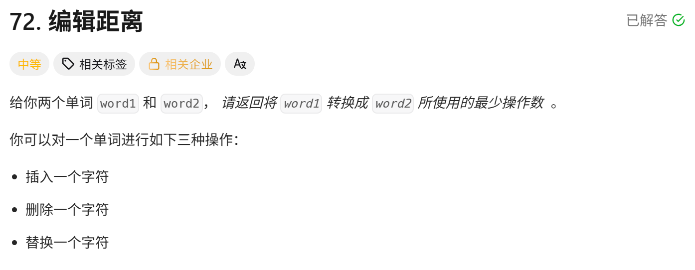

<!-- daily-note-2026-10-14 -->
# 2026-10-14 学习记录

<!-- weather-start -->
## 今日天气
- 当前天气：☁️ 阴天
- 当前温度：24.9 ℃
- 湿度：58 %
- 今日最高温：25.0 ℃
- 今日最低温：16.7 ℃
<!-- weather-end -->

<!-- plan-start -->
> 今日计划：
1.一题，尽量不看AI，直接最优解
<!-- plan-end -->
---
## 今日总结
### 刷题记录
题目1：最长回文子序列

```Go
func longestPalindromeSubseq(s string) int {
    n := len(s)
    if n <=1{
        return n
    }
    dp := make([][]int,n)
    for i:=0;i<n;i++{
        dp[i] = make([]int,n)
    }
    for i:=0;i<n;i++{
        dp[i][i] = 1
    }
    for lenl := 2;lenl<=n;lenl++{
        for i:=0;i+lenl-1<n;i++{
            j:= i+lenl-1
            if s[j]==s[i]{
                if lenl==2{
                    dp[i][j] = 2
                }else{
                    dp[i][j] = dp[i+1][j-1] + 2
                }
            }else{
                dp[i][j] = max(dp[i+1][j],dp[i][j-1])
            }
        }
    }
    return dp[0][n-1]
}
```
```python
class Solution:
    def longestPalindromeSubseq(self, s: str) -> int:
        n = len(s)
        if n <=1:
            return n
        dp = [[0]*n for _ in range(n)]
        for i in range(n):
            dp[i][i] = 1
        for lenL in range(2,n+1):
            for i in range(n-lenL+1):
                j = i+lenL-1
                if s[i] == s[j]:
                    if lenL == 2:
                        dp[i][j] = 2
                    else:
                        dp[i][j] = dp[i+1][j-1] + 2
                else:
                    dp[i][j] = max(dp[i+1][j],dp[i][j-1])
            i +=1
        return dp[0][-1]
```
题目2：编辑距离

```Go
func minDistance(word1 string,word2 string) int{
    m := len(word1)
    n := len(word2)
    dp := make([][]int,m+1)
    for i:=0;i<=m;i++{
        dp[i] = make([]int,n+1)
    }
    for i:=0;i<=n;i++{
        dp[0][i] = i
    }
    for j:=0;j<=m;j++{
        dp[j][0] = j
    }
    for i:=1;i<=m;i++{
        for j:=1;j<=n;j++{
            if word1[i-1] == word2[j-1]{
                dp[i][j] = dp[i-1][j-1]
            }else{
                dp[i][j] = min(dp[i-1][j-1],dp[i-1][j],dp[i][j-1]) + 1
            }
        }
    }
    return dp[m][n]
}
```
```python
class Solution:
    def minDistance(self,word1:str,word2:str) ->int:
        m,n = len(word1),len(word2)
        dp[[0]*(n+1) for _ in range(m+1)]
        for i in range(m+1):
            dp[i][0] = i
        for j in range(n+1):
            dp[0][j] = j
        for i in range(1,m+1):
            for j in range(1,n+1):
                if word1[i-1] == word[j-1]:
                    dp[i][j] = dp[i-1][j-1]
                else:
                    dp[i][j] = min(dp[i-1][j-1],dp[i-1][j],dp[i][j-1])+1
        return d[m][n]
```

### 收获
1. **DP 状态**：`dp[i][j]` = word1 前 i 个字符转为 word2 前 j 个字符的最小操作数。
   - 字符相等：`dp[i][j] = dp[i-1][j-1]`，无需操作
   - 字符不等：取替换、删除、插入三者最小值 + 1
   - 边界：`dp[i][0]=i`（全部删除），`dp[0][j]=j`（全部插入）
2. **实操方法**：动手手动推演 DP 表格，直观验证状态转移，排查逻辑错误。
3. **进阶优化**：二维 DP 可以压缩一维数组，空间复杂度从 O (mn) 降为 O (min (m,n))，需要临时变量保存左上角的值。

> 明日计划：
1.一题，尽量不看AI，直接最优解

---
