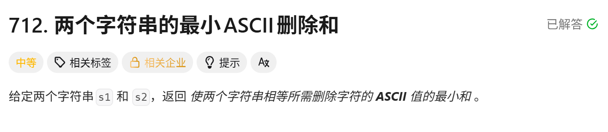
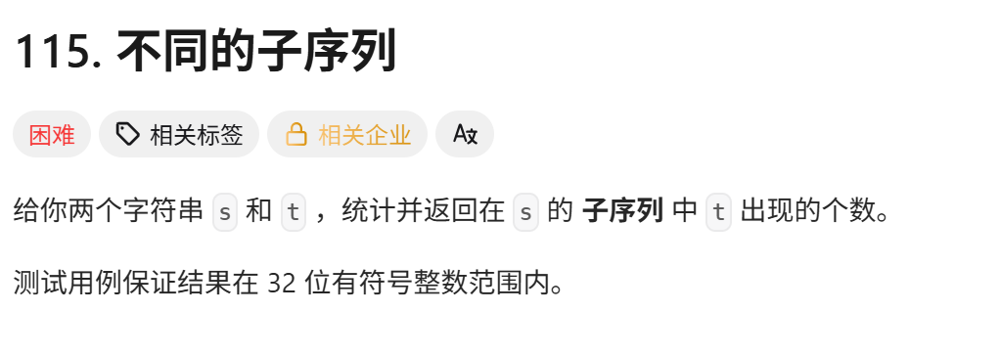

<!-- daily-note-2026-10-15 -->
# 2026-10-15 学习记录

<!-- weather-start -->
## 今日天气
- 当前天气：☁️ 阴天
- 当前温度：22.4 ℃
- 湿度：69 %
- 今日最高温：22.5 ℃
- 今日最低温：18.3 ℃
<!-- weather-end -->

<!-- plan-start -->
> 今日计划：
1.一题，尽量不看AI，直接最优解
<!-- plan-end -->
---
## 今日总结
### 刷题记录
题目1：两个字符串的最小ASCII删除和

```GO
func minimumDeleteSum(s1 string,s2 string) int{
    m := len(s1)
    n := len(s2)
    dp := make([][]int,m+1)
    for i:=0;i<=m;i++{
        dp[i] = make([]int,n+1)
    }
    for i:=1;i<=m;i++{
        for j:=1;j<=n;j++{
            if s[i-1]==s[j-1]{
                dp[i][j] = dp[i-1][j-1] + int(s1[i-1])
            }else{
                dp[i][j] = max(dp[i-1][j],dp[i][j-1])
            }
        }
    }
    total := 0
    for _;v := range(m){
        total += int(v)
    }
    for _;v := range(n){
        total += int(v)
    }
    return total - 2*dp[m][n]
}
```
```python
class Solution:
    def minimumDeleteSum(self, s1:str,s2:str) -> int:
        m,n = len(s1), len(s2)
        dp = [[0]*(n+1) for _ in range(m+1)]
        for i in range(1,m+1){
            for j in range(1,n+1){
                if s1[i-1]==s2[j-1]:
                    dp[i][j] = dp[i-1][j-1] + ord(s1[i-1])
                else:
                    dp[i][j] = max(dp[i-1][j], dp[i][j-1])
            }
        }
        total = sum(ord(c) for c in s1) + sum(ord(c) for c in s2)
        return total - 2*dp[m][n]
```
题目2：不同的子序列

``` Go
func numDistinct(s string,t string) int{
    m := len(s)
    n := len(t)
    dp := make([][]int,m+1)
    for i:=0;i<=m;i++{
        dp[i] = make([]int,n+1)
    }
    for i:=0;i<=m;i++{
        dp[i][0] = 1
    }
    for i:=1;i<=m;i++{
        for j:=1;j<=n;j++{
            if s[i-1]==t[j-1]{
                dp[i][j] = dp[i-1][j-1] +dp[i-1][j]
            }else{
                dp[i][j] = dp[i-1][j]
            }
        }
    }
    return dp[m][n]
}
```
``` python
class Solution:
    def numDistinct(self,s: str,t: str) -> int:
        m,n = len(s),len(t)
        dp = [[0]*(n+1) for _ in range(m+1)]
        for i in range(m+1):
            dp[i][0] = 1
        for i in range(1,m+1):
            for j in range(1,n+1):
                if s[i-1]==t[j-1]:
                    dp[i][j] = dp[i-1][j-1] + dp[i-1][j]
                else:
                    dp[i][j] = dp[i-1][j]
        return dp[m][n]

```

### 收获
今日刷题 2 道：712 最小 ASCII 删除和、115 不同的子序列，均为字符串子序列 DP。712 求最小删除代价，可基于 LCS 思想求解；115 统计子序列匹配方案数量，状态转移为加法。两道题都需要`m+1,n+1`dp 数组处理空串边界，一维空间优化时 115 需要逆序遍历。写 Go 代码时注意循环变量、函数传参符号等手滑 bug。顺带学习 Streamlit 项目云端部署，了解 github+share.streamlit.io 部署流程。

> 明日计划：
1.一题，尽量不看AI，直接最优解

---
