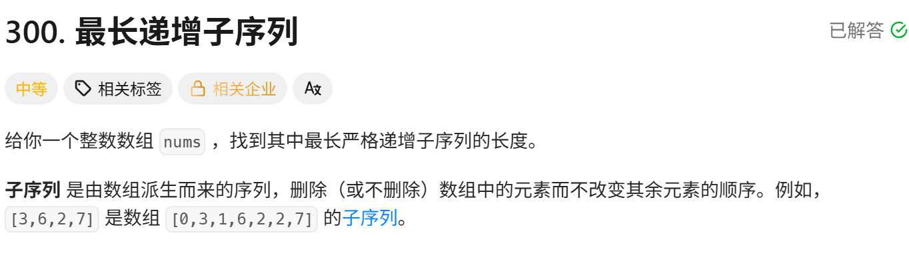
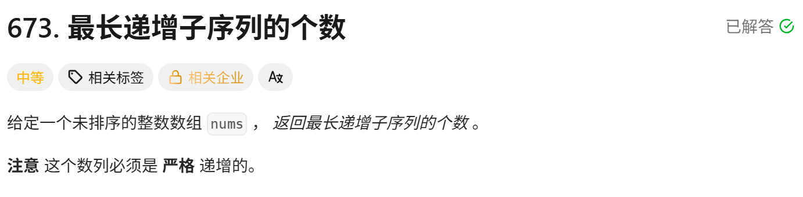

<!-- daily-note-2026-10-16 -->
# 2026-10-16 学习记录

<!-- weather-start -->
## 今日天气
- 当前天气：🌧 中毛毛雨
- 当前温度：22.3 ℃
- 湿度：89 %
- 今日最高温：25.6 ℃
- 今日最低温：19.0 ℃
<!-- weather-end -->

<!-- plan-start -->
> 今日计划：
1.一题，尽量不看AI，直接最优解
<!-- plan-end -->
---
## 今日总结
### 刷题记录
题目1：最长递增子序列

``` Go
func lengthOfLTS(nums []int) int{
    n := len(nums)
    dp = make([]int,n)
    maxlen := 1
    for i:=0;i<n;i++{
        dp[i] = 1
        for j:=0;j<i;j++{
            dp[i] = max(dp[i],dp[j]+1)
        }
        maxlen = max(maxlen,dp[i])
    }
    return maxlen
}
```
``` Python
class Solution:
    def lengthOfLTS(self, nums:List[int]) ->int:
        n = len(nums)
        dp = [0]*n
        maxlen = 1
        for i in range(n):
            dp[i] = 1
            for j in range(i):
                dp[i] = max(dp[i],dp[j]+1)
            maxlen = max(maxlen,dp[i])
        return maxlen
```
题目2：最长递增子序列个数

``` Go
func findNumberOfLTS(nums []int) int{
    n := len(nums)
    dp := make([]int,n)
    cnt := make([]int,n)
    for i:=0;i<n;i++{
        dp[i] = 1
        cnt[i] = 1
    }
    maxlen := 1
    for i:=0;i<n;i++{
        for j:=0;j<i;j++{
            if nums[i] > nums[j]{
                if dp[j]+1 > dp[i]{
                    dp[i] = dp[j] + 1
                    cnt[i] = cnt[j]
                }else if dp[j]+1 == dp[i]{
                    cnt[i] += cnt[j]
                }
            }
        }
        maxlen = max(maxlen,dp[i])
    }
    res := 0
    for i:=0;i<n;i++{
        if dp[i] == maxlen{
            res += cnt[i]
        }
    }
    return res
}
```
``` Python
class Solution:
    def findNumberOfLTS(self,nums:List[int]) ->int:
        n = len(nums)
        dp = [1]*n
        cnt = [1]*n
        maxlen = 1
        for i in range(n):
            for j in range(i):
                if nums[i] > nums[j]:
                    if dp[j]+1 >dp[i]:
                        dp[i] = dp[j] +1
                        cnt[i] = cnt[j]
                    elif dp[j]+1 == dp[i]:
                        cnt[i] += cnt[j]
            maxlen = max(maxlen,dp[i])
        res = 0
        for i in range(n):
            if dp[i] == maxlen:
                res += cnt[i]
        return res
```

### 收获
1. 题目：LeetCode673 最长递增子序列个数
- dp [i]：以 nums [i] 结尾 LIS 长度；cnt [i]：对应最长序列方案数
- 转移：nums [i]>nums [j]，更长则更新 dp [i]、继承 cnt [j]；长度相等则累加 cnt [j]
- 结果：累加所有 dp [i]==maxlen 的 cnt [i]。最初二维 DP 写法存在状态转移、统计逻辑错误。
2. 语言要点
- Python：`[1]*n`生成全 1 列表；二维不能用`[[1]*n]*n`
- Go：make 切片后循环赋初始值；无 int 内置 max，用 if 比较；二维切片逐行 make。
3. 代码优化
合并 dp、cnt 初始化循环，增加空数组边界判断。基础解法 O (n²) 易写；大数据可改用 O (nlogn) 二分版本。
4. DP 刷题心得：先确定 dp 含义，再推导转移，最后设计统计逻辑，定义错则代码难调。

> 明日计划：
1.一题，尽量不看AI，直接最优解

---
